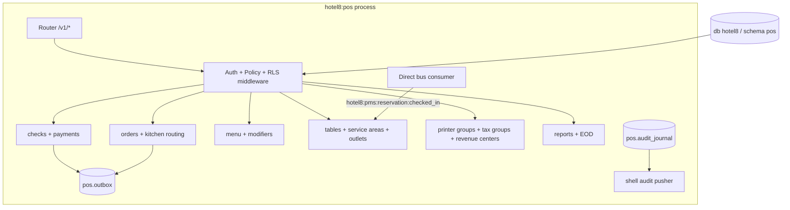

# Hotel8:POS - Point of Sale

## 1. Summary

Hotel8:POS is the food-and-beverage point-of-sale service for the hotel8
vertical: outlets, service areas, tables, menu with modifiers, checks with
split/merge lifecycle, kitchen routing, payments (including room-charge
settlement against PMS folios), printer groups, tax groups, and end-of-day
reporting. It consumes PMS reservation events to prepare tables for arriving
guests and is the platform's issuer of the outlet-level commerce events.

## 2. Motivation

Restaurant and bar service has different shape from room-based selling:
checks are per-table, seat- and course-aware, and they move through
operational stations rather than booking windows. A dedicated POS keeps the
food-and-beverage money path (orders → payments → folio/foreign settlement)
separate from room inventory while staying under the same authorization,
tenant-isolation, and event contracts as the rest of the vertical.

## 3. Architecture & High-Level Design

POS shares the vertical's construction: shell-owned boot (registration,
PQ-TLS, capped pool, Shield engine with hot-reload, outbox relay, audit-journal
pusher), handler-level Shield gating, state machines for check and order
lifecycles, and the standard RFW admin surface.

## 4. Key Traits and Data Structures

- `CheckState` / `OrderState` - pure lifecycle machines (extracted from
  handlers so transition rules are DB-free testable); void-authorization
  policy lives in the handler path, not ad-hoc in each route.
- `Publisher` - caller identity carrier for outbox rows.
- Terminal/register ABAC attributes surface through Shield policies
  (tenant-authored), keeping per-terminal authority data-driven.

## 5. Rationale, Trade-offs, and Alternatives

- **Check lifecycle as a strict machine** - held/void/refund gates are legal
  only from specific states; the machine prevents agent error without
  cross-querying money state. Alternatives (procedural status flags) cannot
  be exhaustively tested.
- **Room-charge as a settlement instruction to PMS** - the check records the
  business event; folio movement is PMS's contract. Direct ledger writes were
  rejected (Bill8:Ledger owns money movement).
- **Offline-first sync events** - terminals work disconnected and reconcile;
  `hotel8:pos:offline:synced` marks convergence rather than silent mutation.
- **Event-first table preparation** - PMS check-in creates table prep
  work without POS polling; the alternative (scheduled reconciliation) adds
  latency without adding correctness.

## 6. Internal Implementation & Invariants (Private Design)

- Payment outcomes mirror to the documented SQL shape (payment result is
  never derived from UI input - only from the settlement path).
- A held check cannot transition to paid without explicit recall; void after
  payment is refused with a refund flow instead.
- Kitchen routing is an outbound event, not a table write - kitchen display
  state is a consumer, not an owner.
- No `unsafe` code; pool access always via the capped helper.

## 7. Unresolved Questions / Future Designs

- Tab pre-authorizations (card tokens held open at the table).
- KDS batching strategies beyond per-order routing.
- Tip pooling/distribution rules.

---

**Design attribution:** hotel8:pos and its underlying concepts were designed by Hamid Jahanzad <Hamid@Jahanzad.com>.
